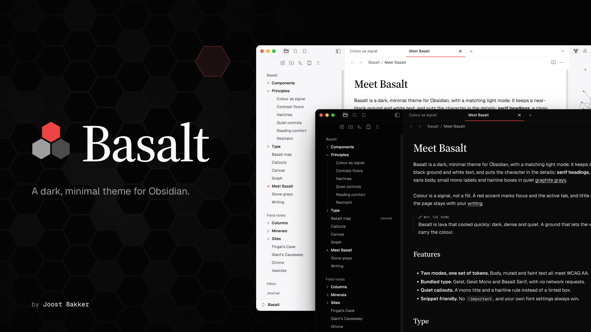
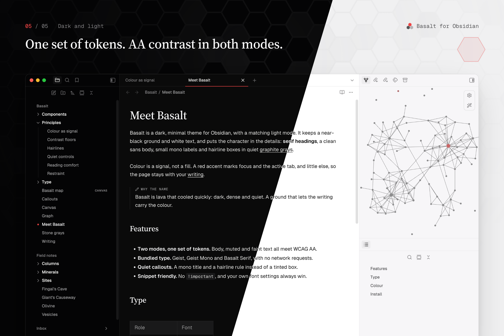
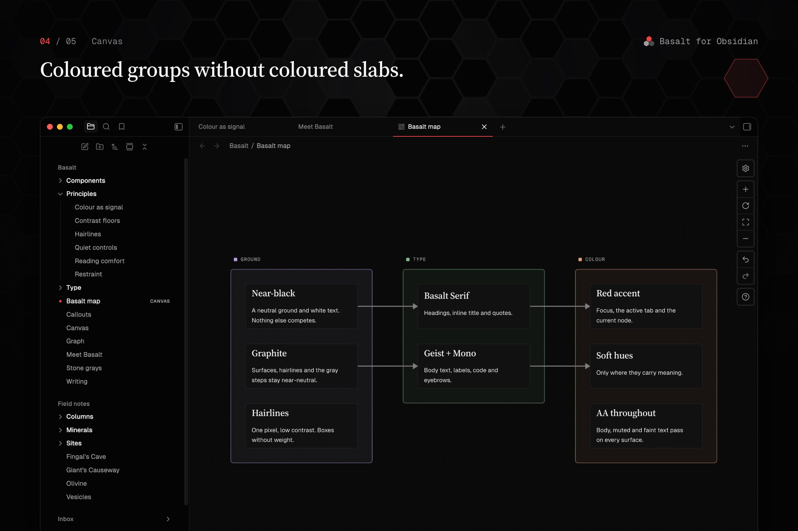
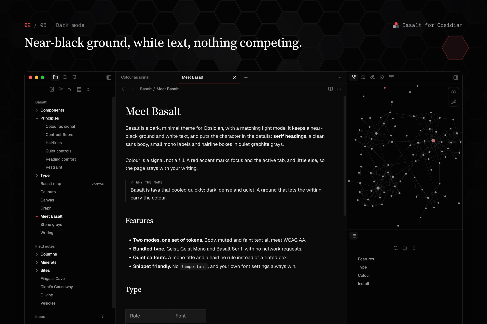
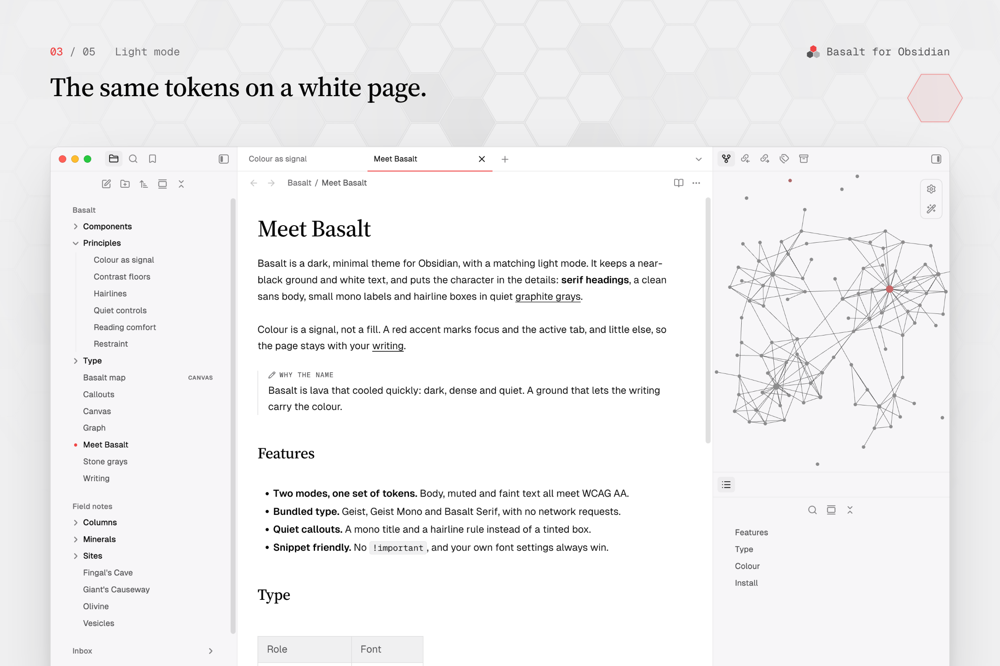
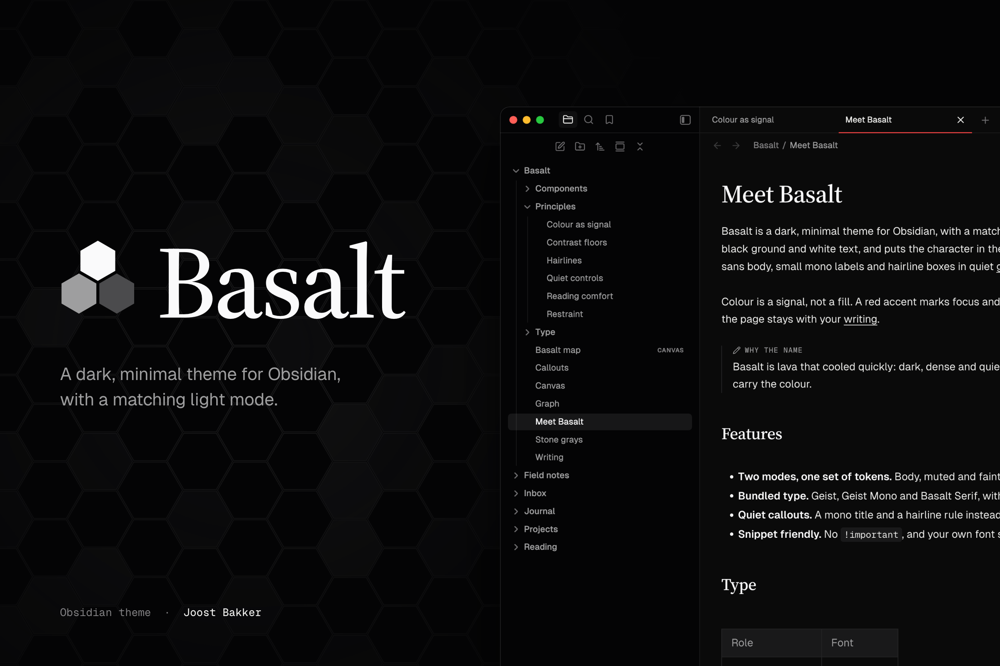

<div align="center">



### Quiet by default.

_A dark, minimal theme for Obsidian, with a matching light mode._

<a href="https://community.obsidian.md/themes/basalt"><picture><source media="(prefers-color-scheme: dark)" srcset="https://img.shields.io/badge/Add_to_Obsidian-ededeb?style=for-the-badge&logo=obsidian&logoColor=0a0a0a"></picture></a>
<a href="https://github.com/joostmbakker/obsidian-basalt/releases/latest"></a>

</div>

## Overview

### basalt (_n._) Lava that cooled quickly: dark, dense and quiet.

Basalt keeps a near-black ground and white text, and puts the character in the
details: serif headings, a clean sans body, small mono labels, hairline boxes
and graphite grays.

**Colour is a signal, not a fill.** A red accent marks focus, the active tab,
the open file and the current note in the graph, and little else. Soft hues
appear only where they carry meaning: callouts, canvas groups and graph colour
groups.



**One set of tokens, two modes.** Light mode is the same design on a white
page, not an afterthought. Body, muted and faint text all meet WCAG AA contrast
on the surfaces they sit on.



## Principles

### Less, but on purpose.

- **The ground stays out of the way**

  Near-neutral graphite surfaces and lines, with the sidebar set just below the
  note. The page belongs to your writing.

- **Type does the work**

  Basalt Serif for headings, Geist for text, Geist Mono for labels and code.
  Hierarchy comes from type and hairlines, not from boxes and fills.

- **Your vault wins**

  No `!important`, styling through Obsidian's own CSS variables, and your font
  and accent settings always take precedence. Snippets keep working.

## Screenshots

<table>
  <tr>
    <td></td>
    <td></td>
  </tr>
  <tr>
    <td></td>
    <td></td>
  </tr>
</table>

## Install

**From Obsidian.** Open **Settings → Appearance → Themes → Manage**, search for
**Basalt**, then choose **Install and use**. Or use the **Add to Obsidian**
button above.

**Manually.** Download `theme.css` and `manifest.json` from the
[latest release](https://github.com/joostmbakker/obsidian-basalt/releases/latest)
into `<your vault>/.obsidian/themes/Basalt/`, then select Basalt under
**Settings → Appearance → Themes**.

Requires Obsidian 1.6 or later. Tested on Obsidian 1.14 (desktop).

## Features

### Components

| Component        | Treatment                                                                      |
| :--------------- | :----------------------------------------------------------------------------- |
| Headings         | Basalt Serif at a medium weight; the inline title matches                       |
| File explorer    | Top-level folders as quiet section labels, and a red dot on the open file      |
| Tabs             | A 1.5px accent rule under the active tab, or one of five other [tab styles](#options) |
| Callouts         | A mono title in the callout colour and a hairline rule, without a tinted box   |
| Canvas           | Mono group labels with a colour swatch and dashed group frames                 |
| Graph            | Monochrome nodes and links, with the accent on the current note                |
| Tables and Bases | Square hairline borders and a quiet header row                                 |
| Properties       | Muted keys above a dashed hairline                                             |
| Controls         | 28px buttons with a hairline ring and an ink primary button                    |
| Empty state      | An editorial new-tab page                                                      |

### Options

With the [Style Settings](https://github.com/obsidian-community/obsidian-style-settings)
plugin installed, **Settings → Style Settings → Basalt** offers a **Tab style**
for the tab bar above notes. Without the plugin, Underline applies.

| Tab style             | Description                                                                 |
| :-------------------- | :-------------------------------------------------------------------------- |
| Underline (default)   | The bar takes the editor colour; a rule marks the active tab                |
| Obsidian              | Obsidian's own tabs                                                         |
| Track                 | Tabs in one bordered track, like a segmented control                        |
| Ink                   | Ghost tabs; the focused pane's active tab takes the ink fill                |
| Sheet                 | The active tab is a bordered sheet that opens into the editor               |
| Indexed               | A compact bar on a dashed hairline, with each tab's Cmd/Ctrl+N numeral     |

### Plugin support

- [Style Settings](https://github.com/obsidian-community/obsidian-style-settings):
  tab style option.
- [Advanced Canvas](https://github.com/Developer-Mike/obsidian-advanced-canvas):
  group labels line up with its collapse toggle.

## Fonts

Bundled and embedded, so the theme makes no network requests. Fonts you set in
Obsidian override these; the theme doesn't touch the `*-override` variables.

- **Geist and Geist Mono**: subsets covering Latin (including extended Latin),
  combining accents, common punctuation, currencies, arrows, maths and keyboard
  symbols. Other scripts use Obsidian's fallback fonts. The full weight range
  and OpenType features of retained glyphs are preserved. © Vercel, SIL Open
  Font License 1.1, see [`src/fonts/OFL.txt`](src/fonts/OFL.txt).
- **Basalt Serif**: a Latin subset of Source Serif 4 (© Adobe, SIL Open Font
  License 1.1; weights 400–700, optical sizes 16–48), used for headings, the
  inline title and blockquotes. Subsetting makes it a Modified Version, and
  "Source" is a Reserved Font Name, so it ships under its own name. See
  [`src/fonts/OFL-SourceSerif4.txt`](src/fonts/OFL-SourceSerif4.txt).

`theme.css` carries both copyright notices and the licence text.

## Reporting issues

Use [GitHub Issues](https://github.com/joostmbakker/obsidian-basalt/issues/new/choose)
to report a bug or request a feature. Search open and closed issues first, and
keep each report focused on one problem. Include Basalt and Obsidian versions,
your operating system, dark or light mode, affected note modes, reproduction
steps and a screenshot when useful. Remove private content before sharing.

For bugs, compare with the default Obsidian theme and, when possible, test with
community plugins and CSS snippets disabled in a sandbox vault. If a plugin or
snippet is needed to reproduce the problem, include a minimal example. Reports
that have not been isolated yet are welcome; say what remains untested.
Basalt targets desktop; mobile is currently untested.

New reports receive `status: needs triage`. Maintainer review sets priority
and an area, then marks the report accepted or needing reproduction. Priority
reflects user impact, not a promised release date.

## Development

<details>
<summary>Build from source, install into a vault, preview harness</summary>

`theme.css` is generated; edit the modules under `src/` and rebuild.

```
src/index.css        build entry: ordered @import list (= cascade order)
src/foundation/      Style Settings options, fonts, tokens, Obsidian variable mappings
src/editor/          note content: headings, code, tables, callouts, ...
src/app/             chrome: workspace, tabs, navigation, controls, overlays, ...
src/views/           canvas, graph, bases
src/fonts/           Geist, Geist Mono and Basalt Serif variable WOFF2 + licences
theme.css            build output, committed because Obsidian installs it
manifest.json        Obsidian theme manifest
images/listing/      community listing banner (00-banner.png) and screenshots
scripts/build.sh     src/ -> theme.css, modules and fonts inlined, CSS minified
scripts/minify.mjs   formatting/comment minifier; retains licences, settings and scan directives
scripts/check.py     design-system check, run by build.sh
scripts/install.sh   build, then copy into a vault
scripts/preview/     DOM-replica screenshot harness
```

### Build

Requires Python 3 and Node.js 22 or later. Install the locked build dependencies
once with `npm ci` (and again when `package-lock.json` changes).

```sh
npm ci
scripts/build.sh
npm test
```

Runs `scripts/check.py` first and stops if it fails. The check keeps colours
inside the token blocks, radii and UI type on their scales, every token defined
and used, and text above its contrast floor. The build then inlines the modules
`src/index.css` imports, in order, replaces the font placeholders in
`src/foundation/fonts.css` with base64 WOFF2 data URIs, and minifies `theme.css`
with cssnano's lite preset. Minification removes formatting and ordinary
comments while retaining font copyright notices and licences, Style Settings,
and compatibility-scan directives. It does not merge rules or rewrite the
design's declarations; the source modules remain readable.
When a local `test-vault/.obsidian` exists (gitignored), it also copies the
theme there.

### Install into a vault

```sh
scripts/install.sh ~/path/to/vault
```

Copies the built theme into `<vault>/.obsidian/themes/Basalt/`. It doesn't
change `appearance.json`; select the theme in Obsidian afterwards.

### Preview harness

`scripts/preview/preview.mjs` screenshots HTML replicas of Obsidian's DOM (tab
bar, graph view and controls, find and replace, notices, empty state, links and
bundled fonts) with
Obsidian's own `app.css` and the built `theme.css`, in dark and light mode, with
hover and focus forced through Chrome DevTools.

```sh
scripts/build.sh
node scripts/preview/preview.mjs /path/to/obsidian/app.css
```

Options: `--only graph,find` (fixtures: `tabbar`, `graph`, `find`, `notices`,
`empty`), `--modes dark`, `--theme other.css`, `--out dir`, `--scale 2`. Output
goes to the gitignored `preview-out/`. It needs Playwright installed globally
(`npm i -g playwright`) and a Chromium it can launch (`CHROMIUM_PATH` to pick
one). `app.css` is Obsidian's file: pass its path, never commit it.

The harness renders replicas, not the app: layout JS, CodeMirror, plugins and
the graph renderer don't run. Confirm visual changes in Obsidian itself, in
dark and light mode, reading and live preview.

</details>

## Credits

### Inspiration

- [**Claude documentation**](https://docs.anthropic.com/) by Anthropic: the
  starting point for early versions (near-black ground, serif headings, hairline
  boxes). Basalt has since moved to its own palette and accent.
- [**Antimetal**](https://antimetal.com/) design system: editorial details such
  as mono labels and dashed hairlines.
- [**Minimal**](https://github.com/kepano/obsidian-minimal) and
  [**Baseline**](https://github.com/svnaxis/obsidian-baseline): the shape of
  this README and the listing.

Basalt is not affiliated with any of these.

### Fonts

- [**Geist**](https://vercel.com/font) by Vercel
- [**Source Serif 4**](https://github.com/adobe-fonts/source-serif) by Adobe,
  shipped as Basalt Serif

## License

The theme code is released under the [MIT License](LICENSE). The embedded fonts
keep their own licence, the SIL Open Font License 1.1 (see [Fonts](#fonts)).
