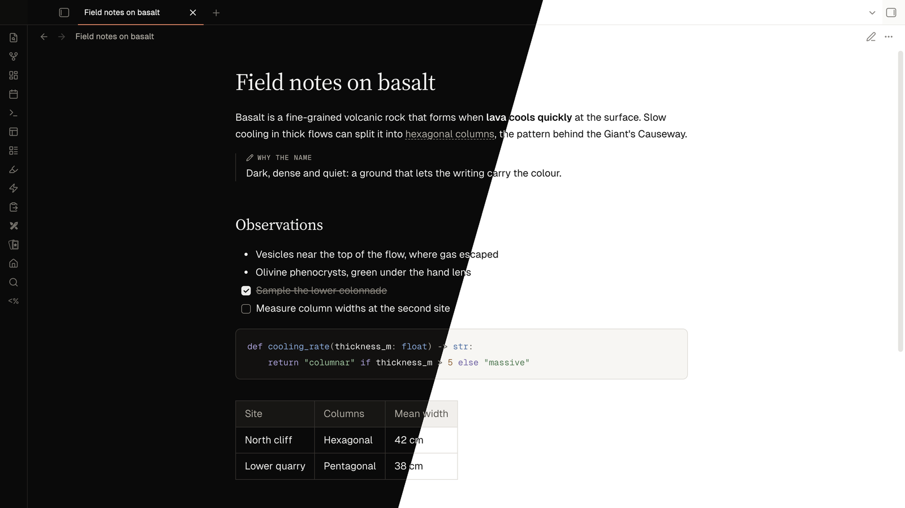

# Basalt

A dark, minimal theme for Obsidian, with a matching light mode.



Basalt keeps a near-black ground and white text, and puts the character in the
details: light serif headings, a clean sans body, small mono labels, hairline
boxes and warm stone grays. Colour is a signal, not a fill: a clay accent marks
focus and the active tab, and little else.

## Features

- **Dark and light modes** from one set of tokens. Body, muted and faint text
  all meet WCAG AA contrast on the surfaces they sit on.
- **Bundled fonts**: Geist, Geist Mono and Basalt Serif (a subset of Source
  Serif 4) are embedded. The theme makes no network requests.
- **Callouts as annotations**: a mono title in the callout colour and a hairline
  bar, without a tinted box.
- **Canvas**: mono group labels with a colour swatch, dashed group frames, and
  labels that line up with Advanced Canvas's collapse toggle.
- **Quiet controls**: 28px buttons with a hairline ring, an ink primary button,
  and an editorial empty state.
- **Snippet friendly**: no `!important`, styling through Obsidian's CSS
  variables, and your own font settings always win.

## Install

From Obsidian: **Settings → Appearance → Themes → Manage**, search for
**Basalt**, then **Install and use**.

Manually: download `theme.css` and `manifest.json` from the
[latest release](https://github.com/joostmbakker/obsidian-theme/releases/latest) into
`<your vault>/.obsidian/themes/Basalt/`, then select Basalt under
**Settings → Appearance → Themes**.

Requires Obsidian 1.6 or later. Tested on Obsidian 1.14 (desktop).

## Options

The tab bar above notes uses **Underline** by default, with no plugin or setup
needed. With the [Style Settings](https://github.com/obsidian-community/obsidian-style-settings)
plugin installed, **Settings → Style Settings → Basalt** offers a **Tab style**:
Obsidian, Underline (default), Track, Ink, Sheet or Indexed.

## Fonts

- Geist and Geist Mono are subsets covering Latin (including extended Latin),
  combining accents, common punctuation, currencies, arrows, maths and keyboard
  symbols.
  Other scripts use the fallback fonts in Obsidian. The full weight range and
  OpenType features of retained glyphs are preserved.
  © Vercel, under the SIL Open Font License 1.1. See
  [`src/fonts/OFL.txt`](src/fonts/OFL.txt).
- Basalt Serif is a Latin subset of Source Serif 4 (© Adobe, SIL Open Font
  License 1.1; weights 400–700, optical sizes 16–48), used for headings, the
  inline title and blockquotes. Subsetting makes it a Modified Version, and
  "Source" is a Reserved Font Name, so it ships under its own name. See
  [`src/fonts/OFL-SourceSerif4.txt`](src/fonts/OFL-SourceSerif4.txt).
- `theme.css` carries both copyright notices and the licence text.
- Fonts you set in Obsidian override these. The theme doesn't touch the
  `*-override` variables.

## Development

`theme.css` is generated; edit the modules under `src/` and rebuild.

```
src/index.css        build entry: ordered @import list (= cascade order)
src/foundation/      Style Settings options, fonts, tokens, Obsidian variable mappings
src/editor/          note content: headings, code, tables, callouts, ...
src/app/             chrome: workspace, tabs, navigation, controls, overlays, ...
src/views/           canvas, graph, bases
src/fonts/           Geist, Geist Mono and Basalt Serif variable WOFF2 + licences
theme.css            build output, committed because Obsidian installs it
manifest.json        Obsidian theme manifest
scripts/build.sh     src/ -> theme.css, modules and fonts inlined
scripts/check.py     design-system check, run by build.sh
scripts/install.sh   build, then copy into a vault
scripts/preview/     DOM-replica screenshot harness
```

### Build

```sh
scripts/build.sh
```

Runs `scripts/check.py` first and stops if it fails. The check keeps colours
inside the token blocks, radii and UI type on their scales, every token defined
and used, and text above its contrast floor. The build then inlines the modules
`src/index.css` imports, in order, replaces the font placeholders in
`src/foundation/fonts.css` with base64 WOFF2 data URIs, and writes `theme.css`.
When a local `test-vault/.obsidian` exists (gitignored), it also copies the
theme there.

### Install into a vault

```sh
scripts/install.sh ~/path/to/vault
```

Copies the built theme into `<vault>/.obsidian/themes/Basalt/`. It doesn't
change `appearance.json`; select the theme in Obsidian afterwards.

### Preview harness

`scripts/preview/preview.mjs` screenshots HTML replicas of Obsidian's DOM (tab
bar, graph view and controls, find and replace, notices, empty state) with
Obsidian's own `app.css` and the built `theme.css`, in dark and light mode, with
hover and focus forced through Chrome DevTools.

```sh
scripts/build.sh
node scripts/preview/preview.mjs /path/to/obsidian/app.css
```

Options: `--only graph,find` (fixtures: `tabbar`, `graph`, `find`, `notices`,
`empty`), `--modes dark`, `--theme other.css`, `--out dir`, `--scale 2`. Output
goes to the gitignored `preview-out/`. It needs Playwright installed globally
(`npm i -g playwright`) and a Chromium it can launch (`CHROMIUM_PATH` to pick
one). `app.css` is Obsidian's file: pass its path, never commit it.

The harness renders replicas, not the app: layout JS, CodeMirror, plugins and
the graph renderer don't run. Confirm visual changes in Obsidian itself, in
dark and light mode, reading and live preview.

## License

The theme code is released under the [MIT License](LICENSE). The embedded fonts
keep their own licence, the SIL Open Font License 1.1 (see [Fonts](#fonts)).
